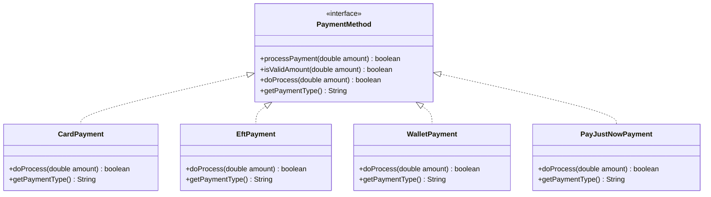

# PayNest Commerce Kernel

PayNest is a Java-based commerce demo designed for small South African merchants who need a simple way to manage products, customers, orders, and payments in a lightweight application.

The project demonstrates core e-commerce concepts through a clean object-oriented design and serves as a practical example of how an order system can be structured in Java.

## Overview

This application allows a merchant to:

- Create and manage products.
- Create and store customer details.
- Build orders for customers.
- Add products with quantities to orders.
- Calculate line totals and the grand total.
- Print clear order summaries.
- Process payments using different payment methods.

The implementation focuses on maintainability and extensibility while keeping the business logic simple and readable.

## Features

### Product Management

- Store product ID, name, and price.
- Calculate product totals based on quantity.
- Keep pricing logic separate from order logic.

### Customer Management

- Create customer accounts with ID, name, and email.
- Associate customers with orders.

### Order Management

- Create orders for customers.
- Add products to orders with quantities.
- Calculate total costs automatically.
- Print formatted summaries for checkout.
- Validate that quantity values are greater than zero.

### Payment Handling

The project uses a `PaymentMethod` interface to provide a common structure for different payment implementations.

Supported payment methods include:

- `CardPayment`
- `EftPayment`
- `WalletPayment`
- `PayJustNowPayment`

The interface includes a default payment-processing method that validates payment amounts before delegating processing to the concrete payment implementation.

This makes it easier to introduce additional payment options without changing the existing checkout logic.

### Testing

JUnit 5 tests cover core functionality, including:

- Order total calculations.
- Quantity validation.
- Service-level order operations.
- Payment processing logic.
- Payment failure handling.
- Correct payment amounts passed to payment implementations.

## Project Structure

```text
src/
├── main/
│   └── java/
│       ├── app/
│       │   └── PayNestApplication.java
│       ├── domain/
│       │   ├── Customer.java
│       │   ├── Order.java
│       │   ├── OrderItem.java
│       │   └── Product.java
│       ├── payment/
│       │   ├── CardPayment.java
│       │   ├── EftPayment.java
│       │   ├── PayJustNowPayment.java
│       │   ├── PaymentMethod.java
│       │   ├── PaymentProcessor.java
│       │   └── WalletPayment.java
│       └── service/
│           └── OrderService.java
└── test/
    └── java/
        ├── domain/
        │   └── OrderTest.java
        ├── service/
        │   └── OrderServiceTest.java
        └── payment/
            └── PaymentMethodTest.java
```

## Tech Stack

- Java 21
- Maven
- JUnit 5

## Prerequisites

- Java 21 or newer.
- Maven installed and available on your PATH.

## Getting Started

### 1. Clone the Repository

Clone the project repository and navigate into the project directory.

### 2. Compile the Project

```bash
mvn clean compile
```

### 3. Run All Tests

```bash
mvn clean test
```

### 4. Run the Demonstration Application

```bash
mvn exec:java
```

Alternatively:

```bash
mvn exec:java -Dexec.mainClass=app.PayNestApplication
```

## Expected Demo

The application creates an order for a customer containing:

- 1 Laptop at R12,000.
- 2 Mice at R200 each.
- 5 Headphones at R1,500 each.

The order total is R19,900.

After displaying the order summary, the application uses `CardPayment` to process the payment.

The payment object is assigned to a `PaymentMethod` interface reference, demonstrating polymorphism. The checkout method accepts the common interface rather than depending directly on a specific payment implementation.

## Example Output

```text
Order summary
========================
Customer: Wesley Henry
Email: wesleyhenry@umuzi.org
========================
Order ID: 1
Items:
- Laptop | x1 | R12000,00
- Mouse | x2 | R400,00
- Headphones | x5 | R7500,00
========================
Total: R19900,00
========================
Processing Card Payment of R19900,00
Payment successful via CARD
Amount: R19900,00
=========================
Payment successful.
Order Completed!
Order ID: 1
Payment Method: CARD
Total Amount Paid: R19900,00
=========================
```

*Note: The example output assumes the payment succeeds and reflects the formatting of the application's current implementation.*

## Payment Design Diagram

The following class diagram illustrates the payment interface and its implementations.



The diagram shows that all four payment classes implement the same `PaymentMethod` interface while providing their own payment-processing behaviour.

## Polymorphism Demonstration

Polymorphism is demonstrated in the `PayNestApplication` class through the following statement:

```java
PaymentMethod paymentMethod = new CardPayment();
```

Here:

- `PaymentMethod` is the interface reference.
- `CardPayment` is the concrete implementation.

The checkout process is then called using:

```java
order.checkout(paymentMethod);
```

The `Order` class works with the `PaymentMethod` interface instead of depending directly on `CardPayment`.

This allows different payment implementations, such as `EftPayment`, `WalletPayment`, and `PayJustNowPayment`, to be passed to the same checkout method.

Java determines which `doProcess()` implementation to execute based on the actual payment object at runtime.

This demonstrates **runtime polymorphism**, where different objects can be treated through a common interface while providing their own behaviour.

## Design Notes

### Why OrderItem Exists

`OrderItem` separates the order into individual line entries so each product can track its own quantity and subtotal independently. This keeps the order model cleaner and easier to extend.

### Why Order Owns Its Items

The `Order` class manages the collection of items so totals remain consistent and validation occurs in one place. This provides a strong foundation for adding future features such as discounts, VAT logic, and stock management.

### Payment Abstraction and Polymorphism

The `PaymentMethod` interface provides a common structure for all payment implementations.

It uses a Java default method to handle shared payment validation and processing logic. Each concrete payment class implements `doProcess()` to provide its own payment-processing behaviour.

This allows the `Order` class to use the same checkout process regardless of the selected payment method.

It also reduces dependencies between classes and makes it easier to introduce additional payment options.

### Extensibility

The design keeps pricing and calculation logic tied to domain objects rather than embedding everything in a single class.

This makes it easier to add new fields or checkout features without disrupting the core application.

## Author

Wesley Henry

IMI Java Trainee